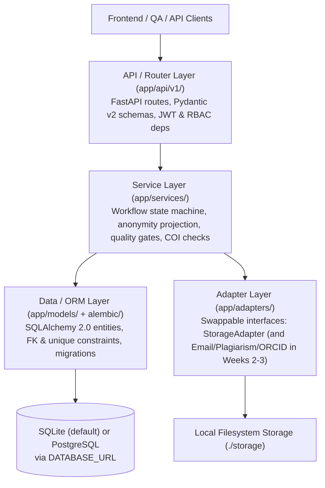
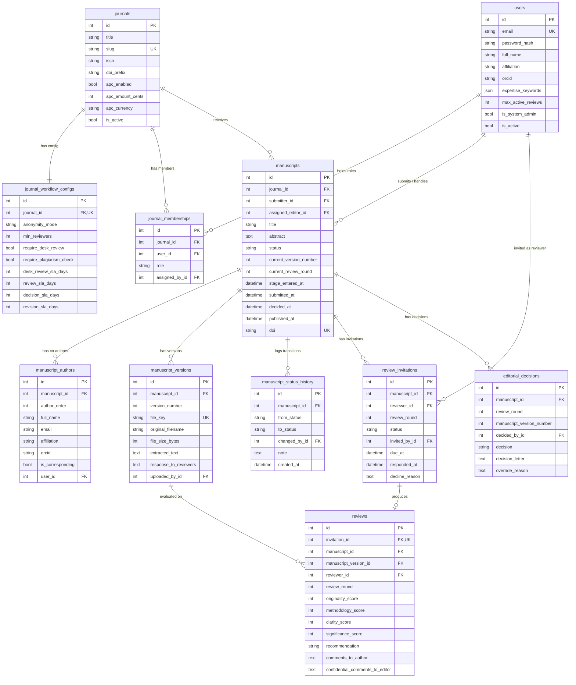
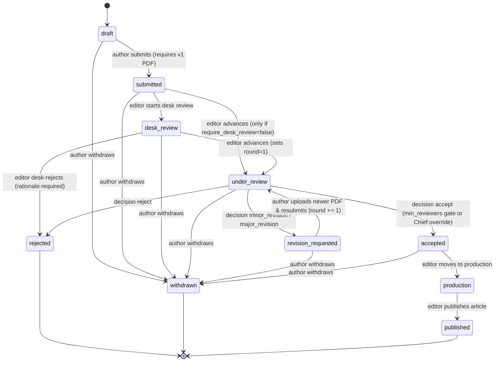
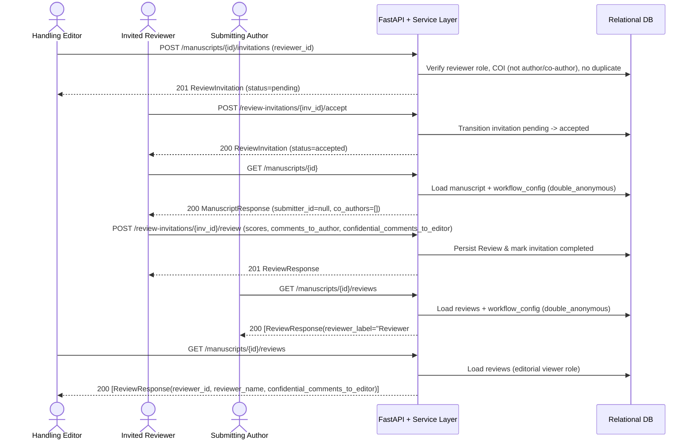

# System Architecture & Diagrams

This document describes the layered modular architecture, relational data model, workflow state machine, and double-anonymous peer-review protocol of the Scholarly Journal Publishing & Peer-Review Management Backend.

---

## 1. Layered Modular Architecture

The backend separates HTTP transport, domain logic, persistence, and swappable external integrations into four strict layers:

- **API / Router Layer (`app/api/v1/`, `app/api/deps.py`, `app/schemas/`):** Handles HTTP routing, request validation, pagination, Bearer JWT extraction, per-journal RBAC dependencies, and structured JSON error envelopes. Never contains raw business rules.
- **Service Layer (`app/services/`):** Owns all business invariants — centralized state-machine transitions (`workflow_service.py`), role- and anonymity-aware DTO projection (`manuscript_service.py`, `review_service.py`), conflict-of-interest checks, and acceptance quality gates (`decision_service.py`).
- **Data / ORM Layer (`app/models/`, `alembic/versions/`):** Declarative SQLAlchemy 2.0 models with explicit foreign keys, unique constraints, check constraints, and portable Alembic migrations.
- **Adapter Layer (`app/adapters/`):** Abstract interfaces with zero-cost local defaults (`LocalFilesystemStorageAdapter`, plus upcoming `EmailAdapter`, `PlagiarismProvider`, and `OrcidClient`) cleanly overridable in `pytest` via FastAPI dependency overrides.

---

## 2. Entity-Relationship Diagram (ERD)

Matches the live Alembic schema through revision `0006_create_editorial_decisions`:

---

## 3. Editorial Workflow State Machine

All transitions are enforced centrally by `app/services/workflow_service.py` and logged immutably to `manuscript_status_history`:

---

## 4. Double-Anonymous Peer-Review Sequence

Illustrates server-side identity masking when `anonymity_mode == double_anonymous`:

